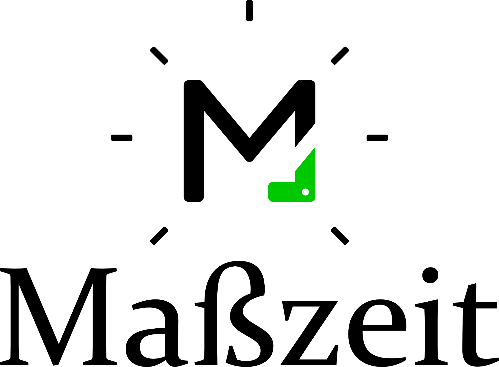
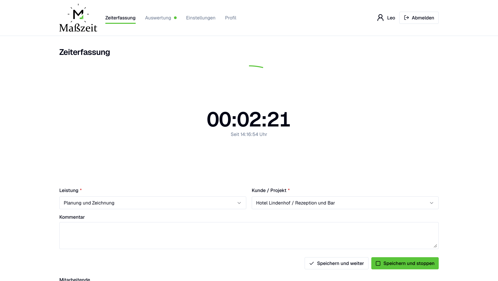
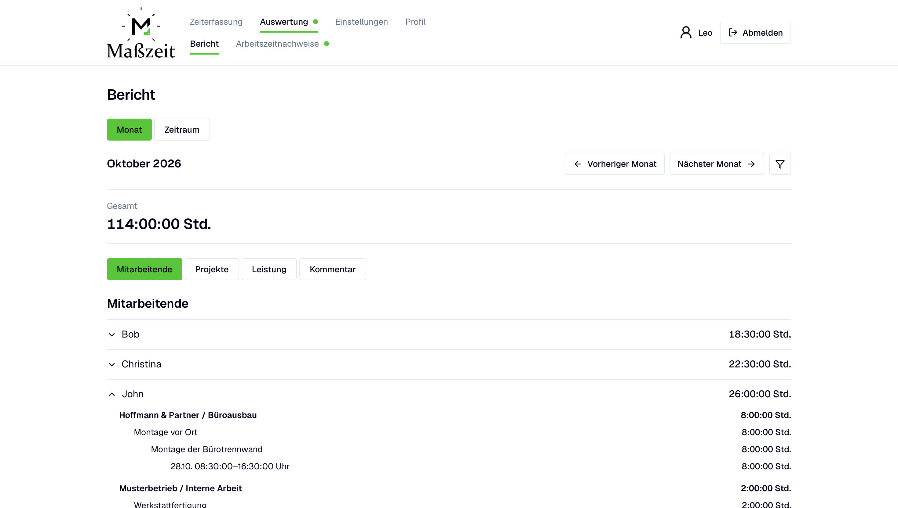
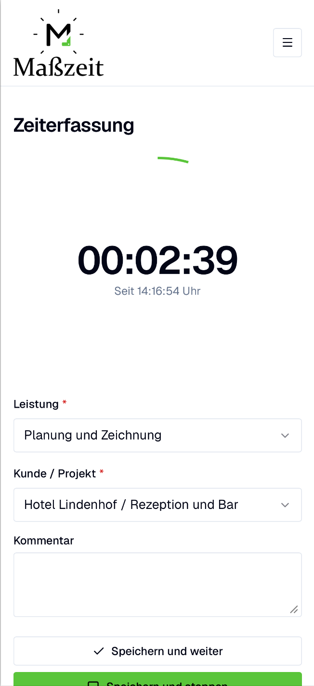
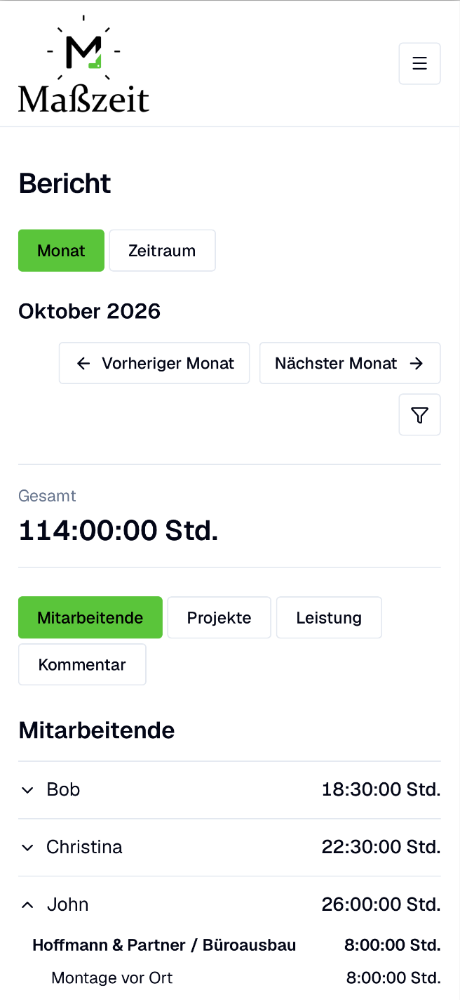

# Project portfolio

A selection of software projects I have worked on.

## Maßzeit

  

**Focused time tracking for everyday use in a small business.**

Maßzeit grew out of a concrete business need: make daily time recording straightforward for employees and give the administrator a clear view of the recorded work. The interface is in German, with mobile recording and desktop administration as the main use cases.

### What the application does

- Records work and breaks with a persistent stopwatch or manual entries.
- Assigns time to customer/project combinations and services, with optional comments.
- Records absence ranges and helps the administrator identify incomplete daily records.
- Provides employee account management, time reports, and encrypted work-record exports.

### Screenshots

The same recording and reporting workflows adapt to desktop and mobile screens. Select an image to open it at full resolution.

**Desktop recording.** The running stopwatch keeps elapsed time prominent, with service, project, and comment fields next to the save actions.

**Desktop reporting.** The expanded hierarchy connects employee totals to projects, services, comments, and individual time intervals.

| Mobile recording                                                                                                                                                             | Mobile reporting                                                                                                                                                             |
| ---------------------------------------------------------------------------------------------------------------------------------------------------------------------------- | ---------------------------------------------------------------------------------------------------------------------------------------------------------------------------- |
|  |  |

### Product and interface decisions

The central design choice was restraint: keep the application focused on the company's everyday workflow. Payroll, invoicing, public registration, and multi-company tenancy are outside its scope.

Daily recording and administration have different needs. The employee workflow centers on the selected day, clear recording controls, and understandable feedback. Administration adds employee management, review, and reports without putting those tasks into the employee interface.

### Engineering decisions

**Persistent recording.** The stopwatch is backed by durable server state so recording can survive page navigation and reconnection. Saving recorded time requires careful handling of retries and partial failures.

**Explicit permissions.** Employees access their own records; the administrator has broader access. Authorization is enforced in server-side operations and PostgreSQL Row Level Security, with a separate, deliberately limited boundary for privileged account operations.

**Time and history.** Exact durations, Europe/Berlin calendar boundaries, corrections, and historical references are part of the data model. Changes to that model are managed through versioned database migrations.

**Verification and operation.** The project includes unit, component, database, and browser tests, as well as migration and recovery checks. Encrypted work-record exports and database backups serve separate purposes.

### Technology

Next.js · React · TypeScript · Tailwind CSS · shadcn/ui · Supabase Auth and PostgreSQL · Vercel · Vitest · Playwright

### About this case study

Maßzeit was developed for a specific company's internal use. The application source and operational repository remain private. This page presents the product and engineering work; it does not provide a reusable application distribution or a public demo.
